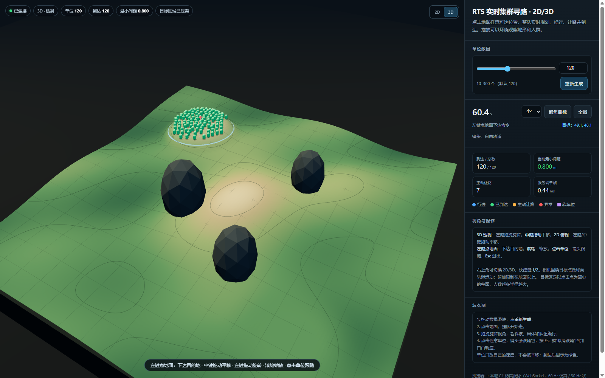
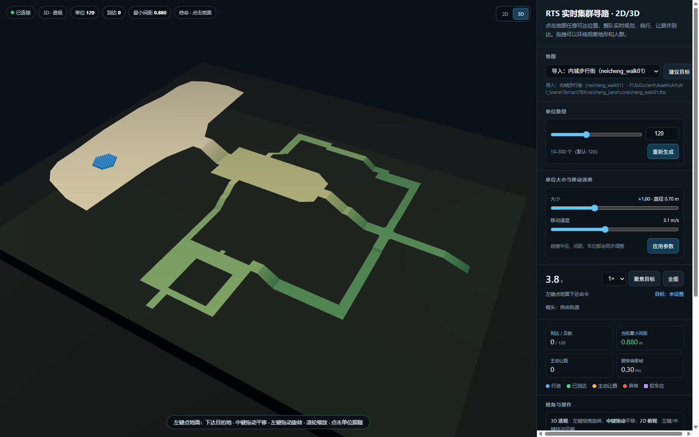
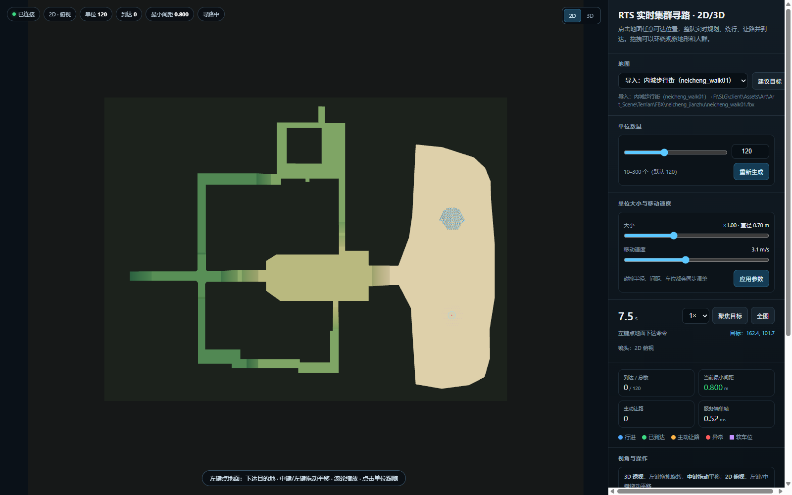
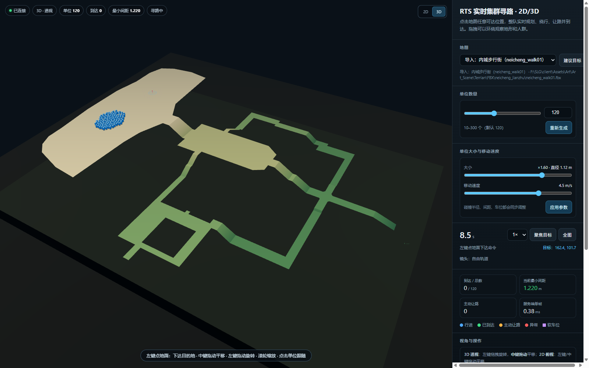
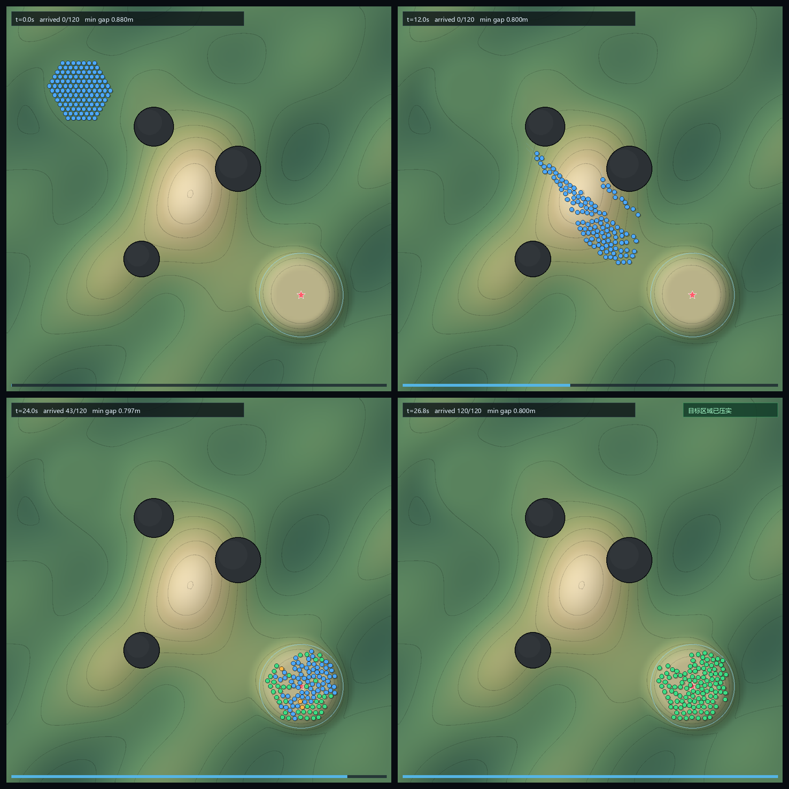
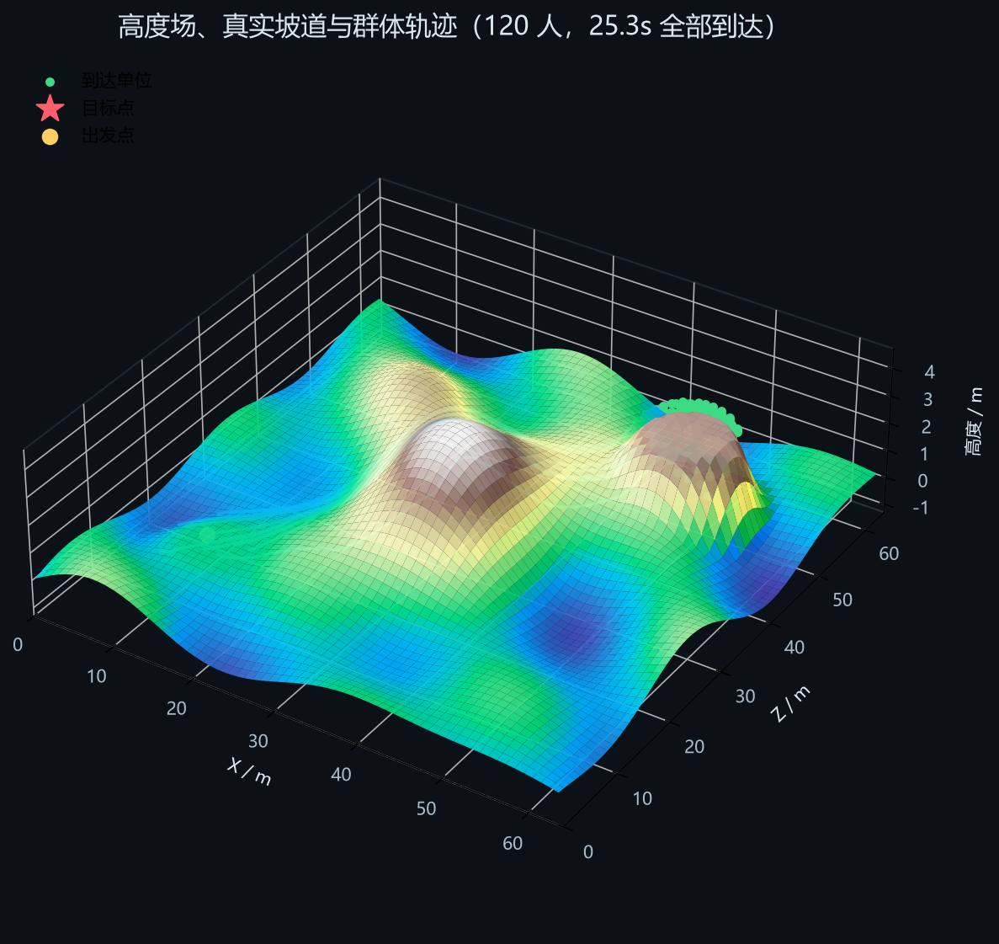
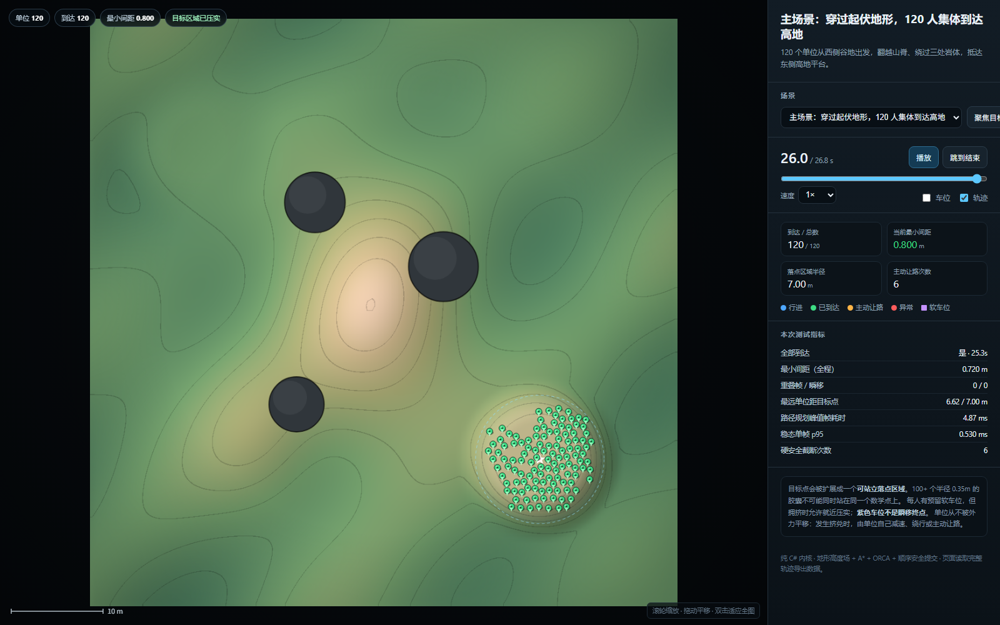

# 3D 地形上的 RTS 群体寻路（100+ NPC）

一个不依赖 Unity 的可运行原型：把 100–300 个 NPC 从 A 点送到 B 点，地形有上坡、下坡、山脊和岩体；要求单位不重叠、不被平移推挤、发生挤兑时自己让路、全程平滑，并且全部到达。

> **先看这里：** [自动测试报告](docs/测试报告.md) · [方案设计](docs/方案设计与实现.md) · [交互演示](http://127.0.0.1:8799/)

## 新增：实时点击测试（RTS 式）

现在可以直接在浏览器里点击地面下达目的地，整队实时走过去；单位数量用滑块/输入框设置，支持 10–1000。

- **当前正在运行：** <http://127.0.0.1:8799/>
- 以后自己启动：双击 [`run-interactive.cmd`](run-interactive.cmd)，或
  `dotnet run --project src/CrowdSim.Interactive/CrowdSim.Interactive.csproj -c Release --no-launch-profile`。
- 页面操作：**左键点击地面 = 下达目的地**；**中键拖动平移**；3D 下**左键拖拽旋转**；2D 下左键/中键拖动平移；滚轮缩放；**点击单位 = 镜头跟随**，Esc 退出；`重新生成` 应用数量；速度支持 1×/2×/4×。
- 右上角可切换 **2D 俯视 / 3D 透视**（快捷键 1/2）。
- 3D 视图：本地 Three.js 透视渲染，地形高度场/岩体/目标整圆都按真实坐标绘制；单位位置用服务端状态插值。2D 是同一场景的正交俯视，不是另一套仿真。
- 浏览器只负责显示，仿真仍由本地 C# 服务执行（WebSocket，60 Hz 仿真 / 30 Hz 状态），与自动测试共用同一套 `CrowdSimulation`。



点击单位后可让镜头跟随：[3D 单位跟随](out/interactive_3d_follow.png)。

右上角切换 2D 俯视：[2D 视图](out/interactive_2d.png)。

## 多地图与 FBX 导入

页面左侧新增**地图**下拉框：

- **默认：山脊与岩体**：程序化高度场；
- **导入：内城步行街（neicheng_walk01）**：从
  `F:\SLG\client\Assets\Art\Art_Scene\Terrian\FBX\neicheng_jianzhu\neicheng_walk01.fbx`
  烘焙出的高度场。

导入不是运行时直接加载 FBX/Unity 网格，而是离线烘焙成仿真能用的规则高度场：

1. 解析 FBX 的 `Vertices` / `PolygonVertexIndex`（该文件是 ASCII FBX，128 个三角面、168 个顶点）；
2. 检查三角形是否都能表示为高度场（全部朝上、同一 x/z 单元格没有上下重叠层）；
3. 以 0.8 m 网格、4 m 边距光栅化；**X/Y/Z 统一缩放 5 倍**，不再只放大水平面，否则台阶高度会被压扁；
   栅格用于 AI，原始三角面单独保留用于显示；
4. 输出 `src/CrowdSim.Interactive/Maps/neicheng_walk01.json`，包含 `heights[]`、`walkable[]`，以及**原始三角面** `mesh.vertices/indices`；
5. 服务端把它加载成 `HeightMap + NavGrid`，A*、ORCA、车位、让路逻辑和默认地图完全共用；
6. 3D/2D 显示使用的是**原始 FBX 三角面**，不是 0.8 m 高度场网格，所以不会出现栅格化造成的边缘凹陷；高度场只负责 AI 净空/碰撞。

转换脚本：`python tools/fbx_to_map.py <file.fbx> <out.json>`。`Maps/` 下的所有 `*.json` 会自动出现在地图下拉框中。

地图切换会重建 `CrowdSimulation`，保留数量/速度设置。每张地图都有“建议目标”按钮；导入地图的出生点在北侧大平台，建议目标在南侧平台。

目标点 UI 只画一个**小标记**，不再画按人数扩张的容量圆。开阔目标下所有单位都朝点击点走，不再把外圈车位当终点；人群真的挤满/被挡住才停。

窄通道同样以点击点为目标，单位沿 A* 路径排队通过；不会再被分配回出生区的车位，也不会出现“原地到达”。





导入地图是 **235×177 格、0.8 m/格**，高度范围约 0–17.8 m；统一缩放后台阶高度和水平尺寸保持原比例。

- 北侧大平台 120 人：22.7 s，120/120；
- 北侧大平台 300 人：24.3 s，300/300；
- 从北侧平台穿过窄口到中央低区，300 人：42.0 s，300/300；
- 300 个 0.5× 单位点进 `95.09, 35.32` 的窄通道：44.7 s，300/300；
  平均距目标约 5.0 m，最远约 11.4 m（通道排队尾巴），但所有人都在持续向目标走。
  早期 3× 缩放时这个窄口只有约 1.2 m，300 人会堵死；5× 后约 2 m，能持续排空。

它目前是**单层可行走表面**；如果以后导入带桥/洞/上下层的 FBX，需要扩展到多层 NavMesh，而不是一张高度场。

### 单位大小与移动速度

右侧新增两个参数：

- **单位大小**：0.5×–2.0×，默认 1.0× = 直径 0.70 m；
- **移动速度**：1.0–6.0 m/s，默认 3.1 m/s；
- 点“应用参数”后服务端重建碰撞半径、`NavGrid` 净空、车位间距和出生队形；客户端同步放大单位模型和阴影。
- 上方的 **1×/2×/4×** 仍然只是仿真播放倍速，和移动速度不是一回事。



## 快速运行

需要 .NET SDK 10（核心库目标为 `netstandard2.1`，Unity 可以直接拷贝源码）。

```powershell
# 1. 自动测试（约半分钟；输出 out/test_report.md）
dotnet run --project tests/CrowdNav.Tests/CrowdNav.Tests.csproj -c Release

# 2. 主场景：120 人，穿越起伏地形
dotnet run --project src/CrowdSim/CrowdSim.csproj -c Release -- flagship 120

# 3. 迟到增援：先 100 人到达，再追加 40 人，已到达单位重新排队腾空间
dotnet run --project src/CrowdSim/CrowdSim.csproj -c Release -- late 140

# 4. 导出可视化数据
dotnet run --project src/CrowdSim/CrowdSim.csproj -c Release -- flagship 120 export
dotnet run --project src/CrowdSim/CrowdSim.csproj -c Release -- packing 160 export
dotnet run --project src/CrowdSim/CrowdSim.csproj -c Release -- late 140 export
```

实时点击 Demo 是 **3D 透视**；下面这个单文件版是**预录回放**，仍是 2D 俯视，便于逐帧检查指标。直接双击打开 [`visualizer/crowd_demo.html`](visualizer/crowd_demo.html) 即可播放（数据已内嵌，不依赖服务器）；开发版在 [`visualizer/index.html`](visualizer/index.html)，读取 `data/*.js`。用滚轮缩放、拖动平移；放大到目标区可以看单位如何让路、压实。

静态结果：





完整过程（约 4 MB，约 3 倍速）：[out/flagship_crowd.gif](out/flagship_crowd.gif)。

预录回放的最终状态（2D 俯视，便于对指标）：



## 结论：采用的方案

**高度场导航网格 + 时间分片 A* + 视线拉直 + ORCA 局部避让 + 目标落点车位 + 顺序安全提交 + 主动让路/落点压实。**

这不是“Unity NavMeshAgent 直接寻路”的做法。Unity 自带寻路适合快速接入，但 100+ 单位时局部避让容易推挤、穿插、绕圈；RTS 需要的是可预测的群体交通流。这里把寻路、避让、目标落点拆成三层：

1. **路径层**：在带高度和坡度的网格上 A*，按坡度计代价；每帧只规划 2 条路径，避免点击时卡顿。
2. **局部层**：ORCA/RVO2 风格的互惠速度障碍，单位通过改变自己的速度避让；从不直接改别人的位置。
3. **落点层**：把点击点扩展成可容纳整队的六边形车位区域；每人一个软车位。已到达单位挡住后来者时，会自己走到临时空位，过一会儿再回来；增援到达后，整队重新排队，前面的人给后面的人腾空间。

关键设计取舍见 [docs/方案设计与实现.md](docs/方案设计与实现.md)。

## 实测结果

环境：Intel i7-14700F / .NET 10 / Release。完整数据见 [docs/测试报告.md](docs/测试报告.md)。

| 场景 | 单位 | 全部到达 | 最小间距 | 重叠/瞬移 | 规划峰值 | 稳态 p95 | 最终离目标最远 |
|---|---:|---:|---:|---:|---:|---:|---:|
| 起伏地形主场景 | 120 | 26.8 s | 0.720 m | 0 / 0 | 5.4 ms | ~0.47 ms | 6.62 / 7.00 m |
| 目标区压力 | 160 | 12.4 s | 0.720 m | 0 / 0 | 2.7 ms | ~0.39 ms | 7.56 / 8.00 m |
| 平地压力 | 200 | 15.7 s | 0.785 m | 0 / 0 | 0.1 ms | ~0.52 ms | 8.16 / 9.00 m |
| 平地 300 人 | 300 | 30.3 s | 0.720 m | 0 / 0 | 1.7 ms | 1.284 ms | 11.35 / 12.00 m |
| 迟到增援 | 140 | 84.0 s | 0.720 m | 0 / 0 | 1.5 ms | ~0.20 ms | 7.37 / 8.00 m |
| 中途改目标 | 80 | 27.6 s | 0.730 m | 0 / 0 | 1.5 ms | ~0.16 ms | 5.97 / 6.00 m |

“最终离目标最远”不是车位误差：落点区域半径由人数决定，100+ 个单位不可能同时站到同一个数学点上。所有单位都进入了这个区域，并且没有重叠。车位是软目标；拥挤时会就近压实。测试同时验证了最短间距、重叠帧、瞬移、到达后残余移动、静态障碍可走性、路径规划是否完成。

> 迟到增援场景的 84.0 s 包含“先等第一队压实、到 t=60 s 才追加单位”的等待时间；追加后重新排队和全部到达约 24 s。
>
> 目的地仍然是**以点击点为圆心的整圆**（300 人半径约 12 m）。改动在车位分配：不再按圆环角度把后排单位硬塞到远侧车位，而是把队伍原来的相对队形整体映射到目标圆内。这样整圆最终会被填满，但没有人需要为了“填满远侧”而绕过整个人群。

## 目录

```
src/CrowdNav/                纯 C# 核心（无 UnityEngine 依赖，netstandard2.1）
  CrowdSimulation.cs         固定步长仿真、命令、让路、落点压实
  PathFinder.cs              A* + 视线拉直
  GoalLayout.cs              六边形车位布局与分配
  OrcaSolver.cs              ORCA 线性规划（RVO2-CS 的 Apache-2.0 适配）
  NavGrid.cs                 高度场、坡度、静态净空、线段净空
  SpatialHash.cs             邻居查询
  Math/几何/Agent 等
src/CrowdNav.Scenarios/      场景、测试运行器、轨迹导出
src/CrowdSim/                命令行入口（-- export）
src/CrowdSim.Interactive/    实时 Demo：ASP.NET Core WebSocket + Three.js 3D/2D
  Maps/neicheng_walk01.json  从 FBX 烘焙的可行走高度场（地图数据）
  wwwroot/                   3D/2D 页面、Three.js、交互
tests/CrowdNav.Tests/        无第三方测试框架的自动验收测试
visualizer/                  预录 2D 回放（本地文件直接打开）
docs/                        方案设计、测试报告、Unity 接入
Unity/CrowdRunner.cs         Unity MonoBehaviour 接入示例（未在 Unity 工程中编译）
out/                         测试报告、关键帧、3D 图、GIF、实时测试截图
tools/                       可视化、报告、WebSocket/CDP 测试、FBX→高度场脚本
run-interactive.cmd          启动实时点击 Demo
```

## 要求与实现对照

| 你的要求 | 实现 |
|---|---|
| 单位不能重叠 | 水平胶囊；每 tick 对移动线段做扫掠检查，提交后再次校验；最小间距 0.72m，测试 0 重叠帧 |
| 不能把别人平移挤开 | 只修改自己的速度；没有冲量、没有位置修正、没有 NavMeshAgent 式推挤；被挡单位自己减速/绕行/让路 |
| 前车占满目标时后车仍能接近 | 目标区软车位 + 已到达单位主动让路（3 s 后返回）+ 迟到增援时整队重新排位；后期允许在目标区域内就近压实 |
| 平滑、无抖动/瞬移 | ORCA 互惠避让、加速度上限、固定 60 Hz、路径视线平滑；测试 0 次瞬移，到达后残余移动 0 |
| 全部到达、不跟丢、不提前停 | 时间分片 A*、卡住重规划、落点压实；自动测试逐单位检查 `Arrived`、路径完成和目标区域距离 |
| 100+ 单位、不卡 | 邻居空间哈希、每 tick 2 条路径分片、稳态无每帧堆分配；120 人稳态 p95 ~0.47 ms，200 人 ~0.52 ms，300 人 ~1.28 ms（本机） |

## Unity 接入

核心是纯 C#，不引用 `UnityEngine`。把 `src/CrowdNav/*.cs` 拷入 Unity 的 `Assets/CrowdNav/` 即可。`Unity/CrowdRunner.cs` 给出了：

- 从 `Terrain.SampleHeight` 构建高度场；
- 把圆形岩体/障碍标记成 `CircleObstacle`；
- 鼠标点击转成 `Vec2` 目标；
- 固定步长推进仿真；
- 把 `Agent.Position` 和地形高度同步到 `Transform`。

详细步骤和性能建议见 [docs/Unity接入指南.md](docs/Unity接入指南.md)。

## 必须说明的边界

- **“全部到达”是到达目标圆形落点区，不是每个人都精确踩在同一个点上。** 半径 0.35m 的 120 个胶囊至少需要几十平方米；把点击点扩展成圆形落点区是不重叠前提下最实用的做法。车位按队伍相对队形整体映射，不要求每个人精确到车位坐标；最终允许在圆内就近压实。
- 单位是水平圆盘/胶囊；不是带跳跃、飞行、攀爬的完整 3D 体。
- 当前静态障碍是圆形 + 高度场坡度；没有动态障碍、门、电梯。
- 极端密度或死胡同仍可能形成局部死锁；本实现用让路、重规划和压实来降低概率，不宣称对任意几何体都能在有限时间内完成。
- 这是原型/可移植核心，不是 Unity 成品工程；Unity 示例未编译。生产环境大规模地图建议把路径层替换为 Recast/Detour，保留本项目的落点与“无推挤”提交层。

## 第三方

ORCA 求解器的半平面构造与线性规划改编自 [RVO2-CS](https://github.com/snape/RVO2-CS)（Apache-2.0，University of North Carolina at Chapel Hill）。原始版权头保留在 `src/CrowdNav/OrcaSolver.cs`。完整许可见 [LICENSES/Apache-2.0.txt](LICENSES/Apache-2.0.txt) 和 [THIRD_PARTY_NOTICES.md](THIRD_PARTY_NOTICES.md)。
