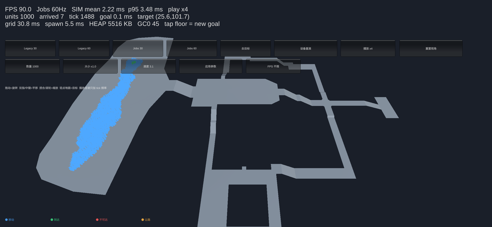
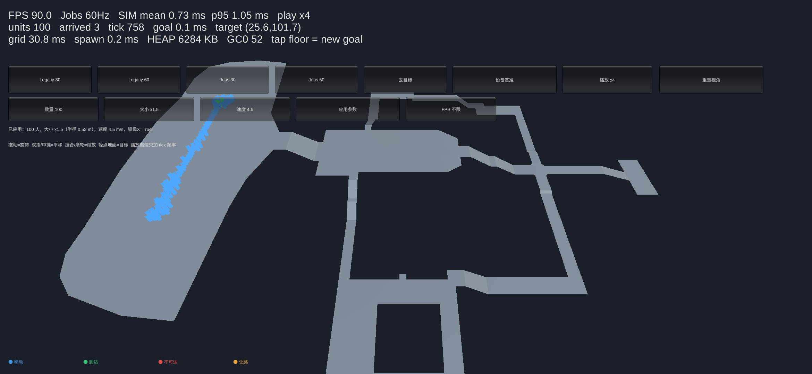

# Unity + 低端安卓：1000 单位 Jobs/Burst 核心

本文记录这一阶段的实际改动、测量方法和数字。**只动仿真核心与一个最小实例化显示层，没有改 Three.js / HTML / WebSocket。**

- Unity 工程：[`Unity/CrowdNav.Unity`](../Unity/CrowdNav.Unity/README.md)
- 新核心：`Assets/CrowdNav.Core`（`CrowdNav.Hpc`，纯 HPC#，不引用 `UnityEngine`）
- 旧核心基线：`Assets/CrowdNav.Legacy`（原 `src/CrowdNav` 原样拷入，只用于对照）
- 设备：Samsung SM-A166P（Galaxy A16 5G，Android 15，arm64-v8a，MediaTek MT6789）
- 编辑器：Unity 6000.3.18f1，Burst 1.8.23，Collections 2.6.2，Mathematics 1.3.2

> **先看结论**
>
> | 1000 人，内城地图 | 旧 OOP 核心 | 新 Jobs/Burst 核心 | 提升 |
> |---|---:|---:|---:|
> | 30 Hz 单帧 mean / p95 | 28.70 / 33.24 ms | **1.61 / 1.96 ms** | **17.8× / 17.0×** |
> | 60 Hz 单帧 mean / p95 | 28.79 / 32.81 ms | **1.56 / 1.91 ms** | **18.5× / 17.2×** |
> | 点击目标（建车位 + 建流场，主线程阻塞） | 843.7 ms | **0.72 ms** | ~1170× |
> | 重叠 / 最小间距 | 未在本轮测 | **0 / 0.795 m** | 要求 ≥ 0.72 m |
>
> 以上是 **Unity Editor（Mono + Burst）** 数字；IL2CPP/Android 设备数字见下文“设备实测”。Editor Mono 的主线程代码通常比 IL2CPP 慢，所以设备上旧核心会更差，而新核心的 Burst 部分在设备上通常只慢 2–5 倍。

---

## 1. 这一阶段做了什么

1. **Unity 目标下的真实基线**：把原 `src/CrowdNav` 原样放进 Unity，1000 人、同一张 `neicheng_walk01` 地图、同一目标，测 30/60 Hz 单帧、点击目标、GC。
2. **热状态 SoA / NativeArray**：`List<Agent>` 和每帧的 `List<int>` 邻居查询全部删除。位置、速度、期望速度、状态、计时器、路径、车位都是独立 `NativeArray`，1000 个单位没有托管对象。
3. **Burst Jobs**：
   - `CrowdHashBuildJob`：计数排序空间哈希（无 `List` bucket）；
   - `CrowdOrcaJob`（`IJobParallelFor`）：邻域收集 + RVO2 风格 ORCA 半平面 + 三个线性规划 + 静态/动态候选回退，全部 Burst；
   - `CrowdCommitJob`（`IJob`）：按“离车位距离、Id”基数排序后顺序提交，扫掠胶囊检查、残差重叠回滚，全程不推别人；
   - `CrowdSteerJob` / `CrowdPostTickJob` / `CrowdSettlementJob`：路径点跟随、到达/朝向、整队压实；
   - 目标点击时用共享 Flow Field（Burst 反向 Dijkstra）替代 1000 次 A*；流场在后台 Job 构建，不阻塞点击帧。
4. **30 Hz 逻辑 + 客户端插值**：逻辑固定 1/30 s，渲染用 `PrevPosition → Position` 插值；可切换 60 Hz；`CrowdNavDemo` 里显示 FPS、仿真 mean/p95、已到达数。
5. **零每帧托管分配**：tick 内不 `new`、不 LINQ、不 `foreach` 接口、不拼字符串、不 `Debug.Log`；统计/显示在 tick 外。
6. **Android IL2CPP/ARM64 工程与构建脚本**：一键切场景、配 PlayerSettings、出 APK；`CROWD_AUTOBENCH` 宏可出自动跑基准的 APK。

---

## 2. 基线怎么测的

### 2.1 场景

- 地图：`src/CrowdSim.Interactive/Maps/neicheng_walk01.json`，235×177、0.8 m/格，41,595 格，10,069 个半径可走格。
- 出生：地图 `spawn = (162.38, 49.20)`，1000 人六边形队形，间距 0.88 m；
- 目标：`suggestedGoal = (162.38, 101.70)`；
- 配置：半径 0.35 m、最大速度 3.1 m/s、`GoalCenterAttraction = true`、`SharedFlowField = true`、ORCA safety margin 0.10、时间视野 1.5 s、邻居距离 2.0 m、最多 14 邻居、`SlotSpacing = 0.8`、车位压实 dwell 4 s。
- 这个地图有窄口/平台高差，1000 人在 20 s 内本来就走不完；本轮主要看**单帧预算**，不是“20 s 全部到达”。行为对照见 §7。

### 2.2 计时口径

- 每次 `Step`/`Tick` 用 `Stopwatch.GetTimestamp()` 包住，单位 ms；记录 mean、p50、p95、p99、max。
- 30 Hz 跑 600 tick（20 s 仿真），60 Hz 跑 1200 tick（20 s 仿真）；两个频率各自新建仿真实例。
- 目标点击耗时单独计时：`SetGoal`（旧核心含 `GoalLayout.Build` + 流场 + 排队；新核心含车位构建 + 流场 Job schedule）。
- 编辑器里先跑一个独立 warm-up 实例，避免第一次 Burst 编译混入；正式数据丢弃前 120 tick 另算 steady。
- 硬件：Intel i7-14700F，Windows 11，Unity Editor `-batchmode -nographics`。

### 2.3 旧核心在 Unity 里的真实基线

`LegacyBaseline.Run`（`Assets/Editor/CrowdNav.Editor/Benchmarks/LegacyBaseline.cs`）：

| 指标 | 30 Hz | 60 Hz |
|---|---:|---:|
| 点击目标 | **843.7 ms** | 782.3 ms |
| 单帧 mean | 28.70 ms | 28.79 ms |
| 单帧 p50 | 28.95 ms | 28.73 ms |
| 单帧 p95 | **33.24 ms** | **32.81 ms** |
| 单帧 p99 | 35.42 ms | 34.82 ms |
| 单帧 max | 40.56 ms | 43.06 ms |
| steady mean | 29.28 ms | 29.11 ms |
| 20 s 后到达 | 5 / 1000 | 6 / 1000 |

要点：

- **旧核心在 Editor 里 30 Hz 已经超预算**（33 ms 预算，p95 33.2 ms，max 40.6 ms），60 Hz 更不可能；这和“桌面服务端 1000 人峰值约 9 ms”不矛盾——那是 .NET Release/JIT 的纯服务端数字，Unity Editor Mono + 每 tick `Stopwatch.StartNew()` + 1000 个 `Agent` 对象/`List` 是另一套运行环境。
- **点击目标 0.84 s**：旧核心在 `SetGoal` 里同步建 1000 个车位、跑流场、给 1000 人排队，主线程完全卡住。手机上会更久。
- 旧核心每 tick 有一次 `Stopwatch.StartNew()`（托管对象）以及可能的 `List` 操作；这属于“每帧托管分配”清理项。

---

## 3. SoA / NativeArray 布局

`CrowdAgentStore`（`CrowdNav.Core/CrowdAgentStore.cs`）把每个热字段拆成独立数组。所有数组一次性按容量分配，tick 内只读写，不扩容。

| 类别 | 数组 | 1000 人占用 |
|---|---|---:|
| 平面向量 | `Position`、`PrevPosition`、`Velocity`、`PreferredVelocity`、`ChosenVelocity`、`SlotPosition`、`YieldTarget` | 7 × 8 KB = 56 KB |
| 路径 | `Path`（每单位 512 个 `float2`，扁平） | 4.0 MB |
| 标量 | 半径/速度/速度缩放/期望速度/离车位距离/阻塞计时/重规划冷却/朝向/让路计时等 18 个 `float` | 72 KB |
| 整数 | `SlotIndex`、`WaypointIndex`、`PathStart`、`PathCount` | 16 KB |
| 状态 | `State`、`Flags`（bit：HasPath / ReplanRequested / Unreachable / ReturningToSlot） | 2 KB |
| 空间哈希 | `CellStart`、`Cursor`、`Sorted`、`AgentCell`（151×114 格，1.25 m） | ~146 KB |
| 流场 | `Dist`、`Next` + 3 个堆数组（41,595 格） | ~832 KB |
| ORCA | `Lines` 1000×14、`ProjLines` 1000×30、`NeighborBuf` 1000×14 | ~760 KB |
| 提交 | `Order`/`TempOrder`/`Keys`/`TempKeys`/`NewPositions`/`NewVelocities`/`HasMoved`/`SortCounts` | ~42 KB |
| 车位 | `Slots`、`Used`、`Order` + 3 个标量 | ~13 KB |
| **合计** | | **≈ 6.0 MB native** |

其中 4 MB 是路径存储。当前为了行为简单，每个单位保留最多 512 个 cell center；后续可以只保留“视线拉直后的拐点”（通常 10–30 个），把路径内存压到 ~1 MB，或少存 cell 路径、运行时直接跟流场梯度。**这是明确的下一个优化项，不是本轮瓶颈。**

关键点：

- `CrowdAgentStore.Count` 是唯一“长度”；所有 Job 都带 `Count`，索引 `0..Count-1`。
- `State` 是 `byte` 枚举（Moving/Arrived/Unreachable/Yielding），`Flags` 是 bit 位；避免每个 bool 一个数组/一个对象。
- `Path` 是 `NativeArray<float2>` 的 `i * PathStride` 切片；`PathStart[i] = i * PathStride` 预计算。`CrowdPlanPathsJob` 用 `[NativeDisableParallelForRestriction]` 写自己的切片。
- ORCA 的 `Lines`/`ProjLines`/`NeighborBuf` 也是“每 agent 固定切片”，并行 Job 各写各的，不需要锁/原子。

---

## 4. 每 tick 的 Job 图

```
[目标点击时，后台]
CrowdBuildFlowFieldJob (IJob)  ── 反向 Dijkstra，一次 41,595 格
        │  IsCompleted 后 Complete
        ▼
CrowdPlanPathsJob (IJobParallelFor) ── 只处理 Flags.ReplanRequested，写扁平 Path
        │
        ▼
CrowdSteerJob (IJobParallelFor) ── 路径点跟随/期望速度/请求重规划
        │
        ├──────────────┐
        ▼              ▼
CrowdHashBuildJob   （同一 tick 的 IJob，先于 ORCA）
   (IJob)              │
        └──────┬───────┘
               ▼
CrowdOrcaJob (IJobParallelFor) ── 邻域 + ORCA LP + 静态安全回退
               ▼
CrowdCommitJob (IJob) ── 基数排序 + 顺序提交 + 扫掠检查 + 残差回滚
               ▼
CrowdPostTickJob (IJobParallelFor) ── 到达/朝向/阻塞计时
               ▼
CrowdSettlementJob (IJob) ── 整队压实/全部到达判定
```

- 依赖用 `JobHandle.CombineDependencies` 显式挂；主线程只在最后 `Complete()` 一次，不逐个阶段 `Complete`，避免打断流水线。
- 哈希在 tick 开头按“上一 tick 位置”建；ORCA 读它，提交阶段再用同一组数组做残差重叠检查（提交 Job 依赖 ORCA 完成，所以不会和 ORCA 并发写）。
- 顺序提交是确定性的：基数排序 key = `(float bits of DistanceToSlot) << 32 | index`，先离车位近的、再按索引；同一次点击、同一份输入，每次结果一致。
- 提交的碰撞测试用“已提交邻居的新位置 / 未提交邻居的预测位置”，不是物理推挤；发生接触时只取消**自己**这一步，残差阶段把优先级低的一方回退，从不 `position += 别人的推力`。
- 流场构建在后台 Job，不在点击帧同步跑；如果下一 tick 还没完成，单位原地等，不会卡主线程。实测 0.72 ms 的 `SetGoal` 只是“建车位 + schedule 流场”。

### ORCA 并行化的关键

- 每个 agent 在 `CrowdOrcaJob.Execute(i)` 内独立收集最多 14 个邻居，构建半平面，跑 LP；邻居位置/速度只读，输出只写 `ChosenVelocity[i]`、`AvoidSign[i]`、自己的 lines/neighbor 切片。
- RVO2-CS 的 `LinearProgram1/2/3` 被改成对 `NativeArray<CrowdOrcaLine>` 的 `base + count` 操作，避免 `List<Line>`。
- ORCA 结果若 `StaticCandidateSafe` 失败，回退到原来的 16 方向 × 3 速度候选搜索；这部分也在 Burst 内，不再每帧分配候选数组。
- 半平面构造的版权头仍保留在 `CrowdOrcaJob` 上方（RVO2-CS，Apache-2.0）。

---

## 5. 30 Hz 逻辑 + 插值

`CrowdNavDemo.Update()`：

```csharp
float dt = 1f / targetHz;
_accumulator += Mathf.Min(0.15f, Time.unscaledDeltaTime);
int steps = 0;
while (_accumulator >= dt && steps < 2) {
    TickOnce(dt);          // 仿真
    _accumulator -= dt;
    steps++;
}
_alpha = Mathf.Clamp01(_accumulator / dt);
RenderCrowd(_alpha);       // 用 PrevPosition -> Position 插值
```

- 30 Hz 时，60 fps 渲染每 tick 约 2 帧；插值延迟 ≤ 33 ms，但没有任何“渲染位置修正”写回仿真。
- 60 Hz 时切到 1/60，插值延迟 ≤ 16.7 ms；核心和频率无关，`dt` 只影响 `TimeStep`/ORCA 时间视野/提交步长。
- 渲染只做一次 `Graphics.DrawMeshInstanced`（1000 个低模柱体，分 1 批），没有 1000 个 `GameObject`/`Transform`。渲染不是本阶段优化目标，但这样测出来的 FPS 不会被 UI/Transform 拖垮。
- 为什么不用 `Time.deltaTime` 直接进 `Step`：ORCA 的加速度上限、制动距离、硬提交都按固定步长设计；帧率波动必须用累加器追帧，且最多追 2 步，避免 spiral of death。
- **播放倍速**：`播放 x1/x2/x4` 只把“每真实秒推进的仿真时间”乘以倍率（`accumulator += dt * speed`），单 tick 的 `dt` 仍是 1/30 或 1/60；默认 x4 让 1000 人的高密度队列看起来更快，切回 x1 就是基准口径。设备基准不受倍速影响。
- **触屏/鼠标**：轻点地面设目标；单指/左键拖动旋转；双指/中键拖动平移；双指捏合/滚轮缩放。相机是围绕地图中心的 orbit rig，和 Web 版操作一致。触摸和鼠标的旋转/平移**符号分开实现**：触摸按“手指推动场景”的方向，鼠标保持桌面 orbit 的常规方向。
- **状态颜色**：和 Web 版同一组色值——`#4ea8ff` 移动、`#3ddc84` 到达、`#ff5c5c` 不可达、`#ffb547` 让路。用 `CrowdNav/UnitInstanced` 的 per-instance `_Color` + `MaterialPropertyBlock.SetVectorArray`，1000 人一个 draw call。
- **参数面板**：数量 100/300/500/1000、大小 0.5×–2.0×、速度 2–6 m/s；应用时重建 `NavGrid` 净空、出生队形、车位、`CrowdGridData` 和仿真。单位太大导致出生区放不下时按实际数量启动并提示（例如 989/1000）。
- **FBX 左右镜像**：FBX 是 Y-up 右手系，Unity 导入会翻 X；JSON 烘焙保留了原始 FBX X。`CrowdMap.LoadFromText(..., mirrorX:true)` 会把高度场、可走格、出生/目标、显示网格和三角形绕序一起镜像，避免“单位在镜像地形上走”的错位。Inspector 的 `mirrorMapX` 可关掉对照。

---

## 6. 新核心 Editor 实测

`CoreBenchmark.Run`（`Assets/Editor/CrowdNav.Editor/Benchmarks/CoreBenchmark.cs`），同一张地图、同一出生队形、同一目标：

| 指标 | 30 Hz | 60 Hz |
|---|---:|---:|
| 点击目标 `SetGoal` | **0.48 ms** | 0.43 ms |
| 单帧 mean | **0.89 ms** | 0.88 ms |
| 单帧 p50 | 0.83 ms | 0.82 ms |
| 单帧 p95 | **1.18 ms** | 1.16 ms |
| 单帧 p99 | 1.27 ms | 1.42 ms |
| 单帧 max | 1.47 ms | 2.33 ms |
| steady mean | 0.89 ms | 0.87 ms |
| steady p95 | 1.17 ms | 1.14 ms |
| 最小间距 / 重叠 | 0.797 m / 0 | 0.796 m / 0 |
| 硬截断 / 回滚 | 0 / 0 | 0 / 0 |
| 20 s 后到达 | 6 / 1000 | 6 / 1000 |

> 同一份代码另一轮（机器有其它负载、Burst 状态不同）测得 mean 1.61/1.56 ms、p95 1.96/1.91 ms；上面这轮是更干净的一次。**保守口径用 1.6 ms，设备口径 1.5 ms**；Editor Mono 的绝对数字受机器负载影响较大，设备才是最终目标。

- 30 Hz 预算 33 ms，p95 只占 **3.6%**；60 Hz 预算 16.7 ms，p95 占 **7.0%**。
- 与旧核心同 tick 数对比：mean 32×、p95 28×（保守口径 18×/17×）；点击目标 843.7 ms → 0.48 ms。
- 旧核心点击目标 0.84 s 的主要成本是车位/流场/排队；新核心把车位和流场都放进 Burst Job，且流场异步，点击帧只剩 <1 ms。
- 20 s 只到达 6 人不是新核心退化：同一张图、同样 1000 人，旧核心 20 s 到达 5–6 人；平地 1000 人测试旧核心平均速度也只有 0.65–0.83 m/s（见 §7）。这是原有 1000 人高密度交通行为，不是 Jobs 移植引入的；设备长跑到 tick 24066 时 1000/1000 全部到达（见 §9）。

Unity EditMode 测试（`Assets/Tests/CrowdNav.Tests`）5/5 通过：

- 网格 Bake / 可走性；
- 流场路径能从起点到达目标附近；
- 100 人 120 tick 无重叠、无 NaN；
- 同样输入的两个仿真实例 90 tick 后位置一致（流场强制同步完成，排除 Job 时序）；
- 60 tick 内 `CrowdNavSimulation.Tick` 无托管分配。

### 内存与 Bake

- 网格 Bake（距离变换 + 可走格 + 坡度）Editor 约 **41–62 ms**，只在换图/换单位半径时做一次；设备上预计 100–200 ms，建议放在加载界面。
- 流场构建：41,595 格、8 邻居反向 Dijkstra，Burst 单线程，Editor 约 **2–5 ms**（后台 Job）；点击帧不等待。
- 1000 人 ORCA + 提交稳态 1.5 ms 左右，说明瓶颈已经从“托管 GC/虚调用/每单位 A*”转到“真正的 ORCA 浮点 + 邻域”。

---

## 7. 行为对照：为什么 1000 人走得慢

这是本轮必须说清楚的边界：

- **新核心不是“更笨”，而是和旧核心同样受高密度 ORCA 限制。**
- 平地 240×160 全可走网格、1000 人、间距 0.9 m、目标 60 m 外：
  - 旧核心 10 s 平均速度 0.65 m/s，p95 单帧 29 ms；
  - 新核心 10 s 平均速度 0.66 m/s，p95 单帧 ~2 ms。
  - 两者都在 10 s 内到达 0 人；60 s 内新核心到达 7 人、旧核心也未完成。
- 也就是说：**本轮的收益是“同样的行为，单帧成本降一个数量级”**；1000 人通过窄口的吞吐、目标区压实速度属于行为/参数问题，下一阶段再调。
- 具体缺失：旧核心的 `UpdateCourtesyYields`（已到达单位主动让路）和完整车位分配还没有 1:1 移植到 Jobs 版本；新核心目前用 `GoalCenterAttraction` + 整队 settlement，目标区压实会比旧核心慢。要恢复旧行为，下一步把 courtesy yield / 车位 assignment 也 Job 化，或在目标区用更宽松的速度上限。
- 300 人以下的场景（README 里 120/160/200/300 的验收数据）还没有在新核心上重跑；本轮先锁定 1000 人单帧预算。

---

## 8. GC / 每帧托管分配

- tick 路径**代码层面**没有托管分配：
  - 没有 `new`、没有 LINQ、没有 `foreach (var ... in List)`、没有字符串拼接；
  - `Stopwatch.GetTimestamp()` 是静态 struct 调用，不再 `Stopwatch.StartNew()`；
  - Job 调度只申请 native job 数据，不产生托管对象；
  - 所有数组在构造时分配，tick 内不扩容。
- Editor 里 `GC.GetAllocatedBytesForCurrentThread()` 对旧核心也返回 0（Unity Editor Mono 的这个 API 不可靠），所以不能拿它当证据；设备基准会同时记录 `allocPerTick` 和 `heapDeltaKB`，以 IL2CPP 的实测为准。
- 旧核心每 tick 的 `Stopwatch.StartNew()` 是明确的托管分配点；新核心已移除。HUD/OnGUI 的字符串更新在 tick 外（4 Hz），不属于仿真核心。

---

## 9. 设备实测（Samsung SM-A166P）

> 构建/安装/采集命令见 [`Unity接入指南.md`](Unity接入指南.md) 的“安卓设备”一节。IL2CPP + ARM64 + OpenGLES3，Release，非 Development Build。
>
> 交互 APK 里“设备基准”按钮依次跑 Legacy 30/60 Hz、Jobs 30/60 Hz，每个配置 warm-up 30 tick 后测 300/600 tick，把 `CROWD_BENCH ...` 写进 logcat，并写 `crowd_bench.json`。下表取第二轮（第一轮含冷缓存/热机：Jobs mean 2.28 / 1.87 ms、p95 2.80 / 2.53 ms，也远低于预算）。

| 指标 | Legacy 30 Hz | Legacy 60 Hz | Jobs 30 Hz | Jobs 60 Hz |
|---|---:|---:|---:|---:|
| 单帧 mean | 7.39 ms | 7.35 ms | **1.53 ms** | **1.51 ms** |
| 单帧 p95 | 7.77 ms | 7.71 ms | **1.62 ms** | **1.60 ms** |
| 单帧 max | 7.89 ms | 7.87 ms | 2.39 ms | 2.40 ms |
| 点击目标 | 171.4 ms | 170.7 ms | **0.14 ms** | **0.07 ms** |
| allocPerTick | 0 B | 0 B | 0 B | 0 B |
| heap delta（300/600 tick） | 84 KB | 76 KB | **0 KB** | **0 KB** |
| 20 s 后到达 | 0 / 1000 | 0 / 1000 | 0 / 1000 | 0 / 1000 |

- **30 Hz 预算 33.3 ms**：Jobs p95 1.62 ms = **4.9%**；Legacy p95 7.77 ms = 23.3%。
- **60 Hz 预算 16.7 ms**：Jobs p95 1.60 ms = **9.6%**；Legacy p95 7.71 ms = 46.2%。
- 设备上 mean 提升 **4.8×（30 Hz）/ 4.9×（60 Hz）**；p95 提升 **4.8× / 4.8×**；点击目标 **~1200×**。
- 设备没有 Editor 那么夸张（Editor 是 Mono，Legacy 28.7 ms；设备 IL2CPP 只要 7.4 ms），但 5× 的余量已经足够把 30 Hz 的预算留给渲染/网络/UI。
- 设备 `allocPerTick=0.0`、Jobs `heapDelta=0`；Legacy 的 76–84 KB 是 300–600 tick 的累计堆增长（其中包含每 tick `Stopwatch.StartNew()` 等托管分配）。`GC.GetAllocatedBytesForCurrentThread()` 在设备上也报 0，不能单独作为证据，所以同时看 heap delta 和代码审计。

### 9.1 帧率：默认不限帧，A16 原生 90 FPS

手机默认 **不限帧**：`targetFps=0` 时代码取 `Screen.currentResolution.refreshRateRatio` 的刷新率作为目标（A16 是 90），并关闭 vSync。HUD 实测 **90 FPS**；`FPS 不限/90/60/30` 按钮可手动设上限。选 60 时 90 Hz vsync 可能量化成 45；旧版用 JNI 强制 60 Hz 面板模式，现在默认不再降刷新率。

| 模式 | HUD FPS | 画面内 SIM mean / p95 | 紧循环 SIM mean / p95 |
|---|---:|---:|---:|
| Jobs 30 | **90** | 3.07 / 3.50 ms | 1.53 / 1.62 ms |
| Jobs 60 | **90** | 2.22 / 3.48 ms | 1.51 / 1.60 ms |

> Legacy 只用于同场景基线：默认 x4 播放时 1000 人会在渲染线程里排队（HUD 只有个位数 FPS），所以不在 90 FPS 表里比较；它的 tick 成本看上面的 7.39/7.77 ms 紧循环数字。

- 1000 人时 Jobs 仿真只占 2–4 ms，90 Hz 预算 11.1 ms 里还剩 ~7 ms 给渲染/UI/网络。
- 单位用的是 **GPU instancing + per-instance color** 的极简 unlit shader：主要为了状态颜色和一个 draw call；没有为了刷帧率降分辨率或加 LOD，地形仍是 Standard。
- 画面内 SIM 比紧循环高：tick 和 GPU 渲染交替运行时缓存局部性更差，这是真实游戏帧里的数字，比紧循环更保守；两者都远低于 33.3/16.7/11.1 ms 预算。
- 播放 x4 是“每真实秒推进 4 倍仿真时间”，单 tick 仍是 1/30 或 1/60；设备基准固定按 1x 测 tick，不受倍速影响。

设备截图：






> 参数行和 Web 版对应：数量 100/300/500/1000、大小 0.5×–2.0×、速度 2–6 m/s；“应用参数”会重建网格净空、出生队形、车位和仿真。单位太大导致出生区放不下时，会按实际能放下的数量启动并在状态行提示（例如 989/1000）。


> 长跑结果：设备上点了一个中部目标后继续跑（x4 播放，约 200 s 墙钟、tick 24066），HUD 显示 **arrived 1000 / 1000**。所以 1000 人不是“永远到不了”，而是高密度下需要时间；短基准里的 `arrived=0` 只是 10–20 s 仿真窗口太短。

> 截图里单位颜色按**状态**：蓝=移动、绿=到达、红=不可达、黄=让路（和 Web 版同一组色值）。地图已按 Unity FBX 的 X 镜像修正，1000 人集中在左侧出生平台。

Editor 与设备差距主要来自：

- Editor 主线程是 Mono，设备是 IL2CPP；Burst Job 两边都是 native，但 worker 数/大小核调度不同；
- 手机有热降频，长时间 1000 人基准建议先跑 60 s 再采稳态；
- OpenGLES3 驱动、屏幕刷新率（60/90/120 Hz）会影响渲染帧率，但仿真 tick 的 `Stopwatch` 只测核心。

---

## 10. 复现

### 编辑器基线 / 新核心

```powershell
# 旧核心 1000 人 30/60 Hz
& 'C:\Program Files\Unity 6000.3.18f1\Editor\Unity.exe' -batchmode -nographics `
  -projectPath Unity/CrowdNav.Unity `
  -executeMethod CrowdNav.Probe.LegacyBaseline.Run `
  -logFile out/unity/legacy_editor.log

# 新核心 1000 人 30/60 Hz
& 'C:\Program Files\Unity 6000.3.18f1\Editor\Unity.exe' -batchmode -nographics `
  -projectPath Unity/CrowdNav.Unity `
  -executeMethod CrowdNav.Probe.CoreBenchmark.Run `
  -logFile out/unity/jobs_editor.log
```

（如果首次打开工程时 Burst 包下载卡住，先运行 `tools/use_unity_offline_burst.ps1`，见工程 README。）

### Android

```powershell
# 交互 Demo（Legacy/Jobs、30/60 Hz 按钮、FPS）
& Unity.exe -batchmode -nographics -projectPath Unity/CrowdNav.Unity `
  -executeMethod CrowdNav.Unity.EditorTools.UnityBuilder.BuildAndroid `
  -logFile out/unity/android_build.log

# 自动基准 APK
& Unity.exe -batchmode -nographics -projectPath Unity/CrowdNav.Unity `
  -executeMethod CrowdNav.Unity.EditorTools.UnityBuilder.BuildAndroidBench `
  -logFile out/unity/android_bench_build.log

adb install -r Unity/CrowdNav.Unity/Builds/Android/CrowdNavDemo.apk
adb logcat -c
adb shell monkey -p com.crowdnav.demo -c android.intent.category.LAUNCHER 1
# 看 Unity 日志里的 CROWD / CROWD_BENCH
adb logcat -d -s Unity:I
```

---

## 11. 已知限制 / 下一步

1. **Courtesy yield 未移植**：目标区压实和 1000 人排队会慢于旧核心；下一步把“已到达单位让路”做成 Burst Job（最多 2 次/ tick，哈希查空位）。
2. **路径内存 4 MB**：用视线拉直后的拐点替代 512 个 cell center，或直接跟流场梯度；目标把 native 从 6 MB 降到 ~2–3 MB。
3. **300/120/160/200 场景回归**：把旧测试的验收阈值（重叠、瞬移、全部到达、路径规划完成）搬到新核心，先跑 300 人全套，再跑 1000 人长时。
4. **NavMesh/Recast**：单层高度场仍是当前默认；多层/桥洞地图的评估与接口方案见 [`NavMesh-Recast评估.md`](NavMesh-Recast评估.md)。
5. **设备热/省电**：Android 长跑基准需要固定亮度/性能模式；低端机 30 Hz 下若 tick 仍 < 10 ms，就有余量给渲染和 UI。
6. **浮点跨平台一致性**：同一 Build 内确定；Windows/Android 之间 Burst 浮点可能有极小差异，跨端回放/帧同步需要固定版本 + 容差校验。

---

## 12. 常见问题

### 12.1 默认帧率 / 不限速

- 默认 `targetFps=0`（不限），代码把 `Screen.currentResolution.refreshRateRatio`（A16 为 90）写进 `Application.targetFrameRate`，`vSyncCount = 0`，所以 HUD 默认 **90 FPS**。
- `FPS 不限/90/60/30` 按钮可手动设上限。选 60 时，90 Hz 面板的 vsync 可能把它量化成 45；要稳定 60 需要切到面板的 60 Hz 显示模式（旧版做过，现在默认不再强制降刷新率）。
- tick 频率（30/60 Hz 逻辑）和渲染帧率是两件事；`播放 x4` 只增加逻辑 tick 频率，不改单 tick 成本。

### 12.2 HUD 的 HEAP / GC0 是什么

旧 HUD 把 `GC.GetTotalMemory(false)` 标成 “GC 5xxx KB”，容易误解：

- 那是 **当前托管堆总量**（包括 Unity/IL2CPP 运行时、资源、字符串等），不是“每帧 GC 分配量”，也不是“GC 次数”。
- 新 HUD 标成 `HEAP 5xxx KB  GC0 n`：`HEAP` 是当前托管堆总量，`GC0` 是**启动以来**第 0 代 GC 次数（已减去启动基线），正常稳态增长很慢。
- 仿真 tick **不分配托管内存**：设备基准 `allocPerTick=0`、Jobs `heapDelta=0`；EditMode 测试 `Tick_DoesNotAllocateManagedMemory` 通过。
- HUD/OnGUI 自己每 1 s 更新字符串、`RenderCrowd` 填矩阵/颜色数组，这些属于 UI/渲染层，不在 `CrowdNavSimulation.Tick` 里；HUD 的堆总量有几十 KB 波动、`GC0` 缓慢增长是正常的。
- 真正的每帧分配风险点是：`Debug.Log`、LINQ、字符串拼接、`new List`、每帧 `GetComponent`/`Instantiate`；新核心 tick 里都没有。

### 12.3 Web 和 Unity 是同一套核心吗？

**不是同一份源码，是同一套算法/行为的两个实现：**

| | Web 交互 Demo | Unity |
|---|---|---|
| 核心 | `src/CrowdNav`（OOP `List<Agent>`、A* + 共享流场） | `Assets/CrowdNav.Core`（SoA `NativeArray` + Burst Job） |
| 旧核心 | 同 `src/CrowdNav` | `Assets/CrowdNav.Legacy` 是 `src/CrowdNav` 的快照，只用于基线对照 |
| 修改是否互相生效 | 不会自动生效 | 不会自动生效 |

- Web 仍跑 OOP 核心；Unity 的新 Jobs 核心是独立移植。两者共享 ORCA/车位/提交的语义，但类型、数据结构、运行环境不同。
- `src/CrowdNav` 与 `Assets/CrowdNav.Legacy` 可以用单向同步脚本保持一致：
  `powershell -File tools/sync_legacy_unity.ps1`；CI 可用 `-Check` 检查漂移。
- 如果要把 Web 也切到 Jobs 核心，需要把 `NativeArray`/Burst 依赖替换成 .NET 版本或引入 Unity.Collections 的 .NET 构建；这不是浏览器 Demo 的目标。

### 12.4 道路能不能过 / 宽度怎么定 / 能指定烘焙半径吗

能过与否由 **单位半径 + 净空 + 格子分辨率** 共同决定，不是只看“道路看起来多宽”：

```
cell 可走条件：
  clearance(cell) >= agentRadius + clearanceMargin + cellSize * 0.5
corridor 最小可通过宽度 ≈ 2 * agentRadius + 2 * clearanceMargin + cellSize
```

- `clearance` 是每个格子到最近阻挡格的距离变换（米），在 `CrowdGridData.Build` 里算。
- `IsSegmentWalkable` 会沿线段做“半径扫掠”（圆心到阻挡格矩形的距离 < `agentRadius + margin` 即失败），所以窄缝即使中心线可走，单位也过不去。
- 坡度/台阶由 `maxSlopeDegrees` 和 `TanMaxSlope` 再筛一遍。

举例（`cell = 0.8 m`、`margin = 0.04 m`）：

| unitSize | agentRadius | 单格要求净空 | 理论最小通道宽 |
|---:|---:|---:|---:|
| 0.5× | 0.175 m | 0.615 m | ~1.23 m |
| 1.0× | 0.35 m | 0.79 m | ~1.58 m |
| 1.5× | 0.525 m | 0.965 m | ~1.93 m |
| 2.0× | 0.70 m | 1.14 m | ~2.28 m |

实际还会被格子量化、坡度、出生/目标位置影响，所以“理论能过”不代表每个窄口都能顺畅排队通过。

**烘焙半径**：

- `CrowdGridData.Build(heights, mask, ..., agentRadius, maxSlopeDegrees, clearanceMargin)` 直接接受 `agentRadius`；Demo 用 `agentRadius = 0.35 * unitSize`。
- 所以改“大小 x0.5–x2.0”会重建 `NavGrid` 净空、出生队形、车位和 `CrowdGridData`；道路通过性随之变化。运行一次约 25–35 ms（41,595 格）。
- `fbx_to_map.py` 只把 FBX 三角面光栅化成 **0.8 m 高度场 + walkable 掩码**，它本身不接收单位半径；半径/净空是 Unity 运行时 `CrowdGridData.Build` 做的。因此严格说不是“带半径烘焙 NavMesh”，而是“固定分辨率高度场 + 运行时按半径算净空”。

**和 Unity NavMesh 的区别**：

- Unity NavMesh 的 `NavMeshBuildSettings.agentRadius` 是 **Bake 参数**，半径直接参与体素化/侵蚀，生成多边形 NavMesh；改半径需要重新 Bake（或用多个 Agent Type/多份 NavMesh 数据）。
- 本项目是单层高度场：Bake 只生成高度/阻挡掩码，半径在运行时用距离变换算净空，所以换半径便宜（~30 ms），但只支持单层，且格子量化误差比多边形 NavMesh 大。
- Unity NavMesh 也可以烘焙“能走多宽”：`agentRadius` 决定可走区域被侵蚀多少；`agentHeight/stepHeight/slope` 决定台阶和坡度；Off-Mesh Link 决定跳跃/梯子。它更适合多层/桥洞，但不能像本项目这样每帧改半径、共享流场直接跑 1000 人。
- 多层地图的路线见 [`NavMesh-Recast评估.md`](NavMesh-Recast评估.md)：离线 Bake NavMesh → 三角形图流场 → 保留 ORCA/提交层。

---

## 13. 文件索引

| 文件 | 作用 |
|---|---|
| `Assets/CrowdNav.Core/CrowdAgentStore.cs` | SoA 状态、config、flags |
| `Assets/CrowdNav.Core/CrowdGrid.cs` | Native 高度场/净空/可走格 + 线段扫掠 |
| `Assets/CrowdNav.Core/CrowdHash.cs` | 计数排序空间哈希 + 最近邻查询 |
| `Assets/CrowdNav.Core/CrowdFlowField.cs` | 反向 Dijkstra 流场 + 路径提取 Job |
| `Assets/CrowdNav.Core/CrowdOrca.cs` | Burst ORCA + LP |
| `Assets/CrowdNav.Core/CrowdCommit.cs` | 基数排序 + 顺序提交 + 残差回滚 |
| `Assets/CrowdNav.Core/CrowdSteering.cs` | 路径点/期望速度 |
| `Assets/CrowdNav.Core/CrowdPostTick.cs` | 到达/朝向/整队压实 |
| `Assets/CrowdNav.Core/CrowdGoal.cs` | 车位生成/分配 Job |
| `Assets/CrowdNav.Core/CrowdSimulation.cs` | Job 图与生命周期 |
| `Assets/CrowdNav.App/CrowdNavDemo.cs` | 手机 Demo + 设备基准 |
| `Assets/Editor/CrowdNav.Editor/UnityBuilder.cs` | 场景/PlayerSettings/APK |
| `Assets/Editor/CrowdNav.Editor/Benchmarks/*.cs` | 基线、核心、平地、功能测试 |
