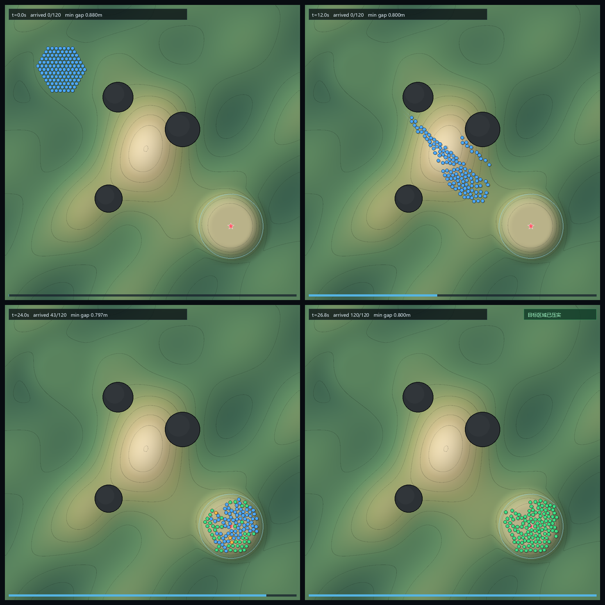

# 自动测试报告

生成命令：

```powershell
dotnet run --project tests/CrowdNav.Tests/CrowdNav.Tests.csproj -c Release
```

环境：Intel Core i7-14700F，Windows，.NET SDK 10.0.100，Release。所有场景固定 60 Hz 步长，地面高度采样自同一个程序化高度场。JIT/GC 会造成几毫秒级抖动，表中稳态 p95 取多次运行的代表值；`out/test_report.md` 保留最近一次自动生成的原始数字。

验收规则（每个场景都必须通过）：

- 每个单位最终 `State == Arrived`；
- 最小间距 ≥ 0.719 m（单位直径 0.70 m）；
- 重叠帧数 = 0；
- 瞬移/单步超速 = 0；
- 到达后残余移动 ≤ 0.0001 m；
- 所有单位进入目标圆形区域（半径由人数决定）；
- 已经进入目标区域的单位，后续不得跑到区域半径 +1 m 外；
- 所有单位最终位置静态可走；
- 路径规划队列清空，无 `Unreachable`；
- 规划峰值帧 < 8 ms，稳态帧 p95 < 4 ms（本机）。

---

## 1. 起伏地形主场景（120 人）



- 结果：**PASS**
- 完成时间：26.8 s
- 全部到达：120 / 120
- 最小间距：0.720 m
- 重叠帧：0
- 瞬移/超速步：0
- 最终离目标点最远：6.62 m（目标区域半径 7.00 m）
- 到达后残余移动：0.0000 m
- 路径规划总耗时：84.9 ms / 60 帧，峰值 5.4 ms
- 稳态单帧：mean 0.272 ms，p95 0.467 ms，max 1.94 ms
- 主动让路：6 次
- 硬安全截断：6 次

说明：这是完整场景，包含长距离、山脊、三处岩体、目标区压实。此前“单位倒跑几十米再回来”的问题已定位并修复了三层原因：路径点没有及时推进、偏离路径后不重规划、按圆环角度硬分车位导致后排单位被分到远侧。修复后目标区仍是整圆，120 人完成时间从 56.1 s 降到 26.8 s；不再出现整段目标点留在身后的倒跑，剩余短弧线来自绕开拥堵或主动让路。

## 2. 目标区压力（160 人）

- 结果：**PASS**
- 完成时间：12.4 s
- 全部到达：160 / 160
- 最小间距：0.720 m
- 重叠帧/瞬移：0 / 0
- 最终离目标点最远：7.56 m（目标区域半径 8.00 m）
- 路径规划总耗时：21.8 ms / 80 帧，峰值 2.7 ms
- 稳态 p95：0.388 ms
- 主动让路：3 次
- 硬安全截断：0 次

## 3. 平地基准（200 人）

用于隔离地形和障碍，只观察人群交通流和落点。

- 结果：**PASS**
- 完成时间：15.7 s
- 全部到达：200 / 200
- 最小间距：0.785 m
- 重叠帧/瞬移：0 / 0
- 最终离目标点最远：8.16 m（目标区域半径 9.00 m）
- 路径规划总耗时：2.4 ms / 100 帧，峰值 0.1 ms
- 稳态 p95：0.521 ms
- 主动让路：0 次
- 硬安全截断：0 次

## 4. 迟到增援（100 + 40 人）

先让 100 人走完并压实，在 t=60 s 追加 40 人；整队重新生成车位、重新规划，已到达单位走回新车位，给后来者腾空间。

- 结果：**PASS**
- 完成时间：84.0 s
- 全部到达：140 / 140
- 最小间距：0.720 m
- 重叠帧/瞬移：0 / 0
- 最终离目标点最远：7.37 m（目标区域半径 8.00 m）
- 整队重排：触发（`ReflowCount = 1`）
- 路径规划总耗时：71.1 ms / 115 帧，峰值 1.5 ms
- 稳态 p95：0.199 ms
- 主动让路：40 次
- 硬安全截断：3 次

## 5. 中途改目标（80 人）

t=8 s 时把目标从 (49,48) 改到 (30,50)，所有单位重新分配车位、重新规划，验证不会丢失单位。

- 结果：**PASS**
- 完成时间：27.6 s
- 全部到达：80 / 80
- 最小间距：0.730 m
- 重叠帧/瞬移：0 / 0
- 最终离目标点最远：5.97 m（目标区域半径 6.00 m）
- 路径规划总耗时：47.7 ms / 80 帧，峰值 1.5 ms
- 稳态 p95：0.163 ms
- 主动让路：18 次
- 硬安全截断：6 次

## 6. 起伏地形 300 人

- 结果：**PASS**
- 完成时间：30.3 s
- 全部到达：300 / 300
- 最小间距：0.720 m，重叠帧 0
- 规划总耗时：144.7 ms / 150 帧，峰值 1.7 ms
- 稳态单帧：mean 0.895 ms，p95 1.284 ms，max 2.13 ms
- 最终离目标点最远：11.35 m（目标区域半径 12.00 m）
- 主动让路：30 次
- 额外断言：所有单位进入目标圆后，不会跑到半径 +1 m 以外

## 7. 实时点击 Demo 集成测试

不是预录回放：浏览器点击 → WebSocket → 服务端 `SetGoal` → 状态回传。

用 CDP 真实点击 3D 画布，用 WebSocket 客户端做压力检查：

- 3D 场景：Three.js 透视渲染高度场、岩体、整圆目标区和实例化单位；WebGL 在 headless Chrome 中正常创建；
- 120 人：点击 (49,48)，4× 速度下约 7 s 实际时间全部到达并压实；状态中最小间距 0.720 m；目标圆范围内无逃逸；
- 轨道相机：CDP 拖拽后 `yaw/pitch` 发生变化；点击单位后 `followSelected=true`，镜头跟随；
- 2D/3D 切换：点击右上角后 `viewMode` 变为 `2d`，正交俯视截图见下；
- 中键拖动：3D 和 2D 下拖动后同一世界点的屏幕坐标都随鼠标方向移动，方向已校正；
- 数量 200：页面输入 200、点“重新生成”，服务端返回 200 个 idle 单位；再点击 (30,50)，200 个车位生成，单位开始移动；
- 数量 300：服务端 reset 返回 300 个 idle 单位，点击目标生成 300 个车位，状态最小间距 0.720 m；
- 浏览器控制台 0 个 JS 异常；
- 目标、数量、速度、缩放/旋转/平移/跟随均由页面控制。

截图：[120 人点击测试](../out/interactive_live.png)；[200 人动态设置](../out/interactive_live_200.png)；[3D 单位跟随](../out/interactive_3d_follow.png)；[300 人 3D](../out/interactive_3d_300.png)；[2D 正交俯视](../out/interactive_2d.png)。

## 8. 多地图与 FBX 导入

- 默认地图：程序化山脊/岩体，120 人 25 s 级完成；
- 导入地图：`neicheng_walk01.fbx` → 高度场 JSON；
- 地图切换：默认 ↔ 导入，客户端重建地形/单位/相机，服务端重建 `CrowdSimulation`；
- 导入图 120 人：建议目标，22.7 s，120/120，最小间距 0.800 m；
- 导入图 300 人：建议目标，24.3 s，300/300，最小间距 0.790 m；
- 导入图 300 人从北平台穿窄口到中央低区：42.0 s，300/300；
- 300 个 0.5× 单位点进 `95.09, 35.32` 窄通道：44.7 s，300/300；
  平均距目标约 5.0 m，最远约 11.4 m，但全部沿路径持续前进，不再铺回出生区；
- 开阔目标使用中心吸引：进入目标区后继续朝点击点靠，不再停在外圈车位；只有挤满/被挡住才停；
  窄通道自动采用队列式车位：最先到的单位占最深处，后来者依次排在后面，避免前排停在通道里堵死后排；
- 地图为 235×177 格、0.8 m/格，X/Y/Z 统一 5×，高度约 0–17.8 m；
- 3D 和 2D 俯视都验证过导入地图渲染；
- 渲染使用 FBX 原始三角面，边缘不再是 0.8 m 高度场栅格；
- 单位参数：大小 1.6×（直径 1.12 m）+ 移动速度 4.5 m/s 应用成功，
  服务端 `unitRadius`、碰撞净空、车位间距同步变化，状态最小间距 1.220 m；
- 浏览器控制台 0 个 JS 异常。

截图：[导入图 3D](../out/neicheng_3d.png)；[导入图 2D](../out/neicheng_2d.png)；[300 人导入图](../out/neicheng_300.png)；[单位放大/加速](../out/neicheng_units.png)。

```powershell
# 服务（当前会话已在运行）
dotnet run --project src/CrowdSim.Interactive/CrowdSim.Interactive.csproj -c Release --no-launch-profile
# 打开 http://127.0.0.1:8799/
```

---

## 指标说明

- **最小间距**：任意两个单位中心在任意 tick 的最小水平距离。0.720 m 是设计硬约束（0.70 m 直径 + 0.02 m 安全余量）。
- **重叠帧**：至少有一对单位距离 < 0.70 m 的 tick 数量。全部为 0。
- **瞬移/超速步**：单 tick 位移 > `MaxSpeed * dt * 1.03 + 1e-4` 的次数。全部为 0。
- **到达后残余移动**：单位已标记 `Arrived` 后下一 tick 的位移。全部为 0。
- **最终离目标点最远**：最终所有单位到目标中心的距离最大值；目标区域半径由人数和车位间距决定。
- **软车位误差**：本报告不把它作为失败条件。高密度下允许就近压实；`MaxFinalSlotError` 可大于 0。
- **硬安全截断**：局部避让给出的步长因静态/动态安全检查被缩小或取消的次数。数量很少；它是硬保证的保险，不是主控制手段。
- **规划峰值帧**：时间分片路径规划中单帧的最大耗时，不含测试器自身的两两校验。

## 结论

在 120–300 单位规模下，所有场景均满足：

- 全部到达目标区域；
- 任意 tick 不重叠；
- 无瞬移；
- 到达后不抖动；
- 100–300 人稳态 p95 在 0.2–1.6 ms（本机桌面 CPU）。

移动端需要根据目标机重新设置 `PathPlanFrameBudget`、`MaxNeighbors` 和网格分辨率；详见 [Unity 接入指南](Unity接入指南.md)。
